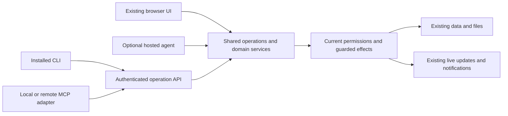

Paste this into your preferred coding agent. For example, use **Codex** with **GPT-6.1 Sol** and **Max** reasoning:

```text
Get https://github.com/cfreshman/agent-access-upgrade-guide and use it to add
agent access to my existing web app.

Clone or download the complete guide into a separate reference directory and
record the revision used. If my target project is not clear from this chat,
ask which local project or repository I want to upgrade before changing it.

Inspect the target's instructions and actual workflows. Give me a brief
walkthrough of the scope, fill in the project worksheet, and follow the guide's
implementation sequence and linked chapters through implementation and verification.

Add shared operations, an installable CLI, local MCP, and named revocable
credentials with browser-approved login or a suitable PAT alternative.
Preserve the existing UI, authored copy, data, sessions, credentials, and
unrelated work. Discover the actual stack, hosting, and release process.
Keep hosted AI, remote OAuth, and new infrastructure optional.

Continue ordinary authorized work without repeated approval questions.
Ask only about unresolved choices that materially affect scope, access,
privacy, cost, or behavior. Follow my existing deployment and Git publication
instructions. Finish with verified workflows, setup instructions, and real limits.
```

# Give your web app useful agent access

Turn an existing web app's workflows into operations that a coding agent or other assistant can discover and use through a CLI and MCP. People keep using the same app. An agent can read current records, make the requested change, and return a result you can verify, without navigating every screen through clicks.

The practical benefit is ordinary work: updating a draft, organizing records, exporting data, or completing an authorized team workflow. The difficult part is preserving what the application already knows about permissions, side effects, and interrupted work. This guide provides a procedure for doing that.

**Start with shared application operations, named revocable credentials, an installable CLI, and local MCP.** Use browser-approved device login or a personal access token (PAT), according to the existing app and intended clients. Hosted AI and remote OAuth integration are optional. There is no required model, programming language, database, hosting provider, or additional service.

## Use this guide

Keep this directory together. It is self-contained and can be copied into a project, attached to an agent conversation, or shared as a folder. Start with [the implementation sequence](implementation.md) and fill in [the project worksheet](project-plan.template.md). Read the focused chapters when you reach the relevant step:

| File | Use it for |
| --- | --- |
| [Implementation](implementation.md) | Inventory, shared operations, staged delivery, optional hosted chat, deployment |
| [Access and authorization](access.md) | Connection login, storage, revocation, and the meaning of human authorization |
| [Revisions and retries](reliability.md) | Concurrent edits, lost responses, receipts, and external effects |
| [CLI, MCP, and files](interfaces.md) | Client behavior, transport compatibility, file handling, and packaging |
| [Deployment and scaling](deployment-and-scaling.md) | Fit any existing hosting/release setup and plan capacity from measured work |
| [Examples](examples.md) | An illustrative contract, request, result, and executor flow |
| [Verification](verification.md) | Concrete acceptance checks and the evidence to report |
| [Reference apps](reference-apps.md) | A public source case study and clearly separated design illustrations |
| [Project worksheet](project-plan.template.md) | Decisions, workflow coverage, and acceptance evidence for your app |
| [Primary sources](sources.md) | Protocol references and the review date |

If the project already has an API, CLI, or connection system, extend it. You may already have much of the operation layer. Avoid rebuilding working infrastructure just to match this guide's example names.

Codex with GPT-6.1 Sol at Max reasoning is one example setup, not a requirement. Use another capable coding agent or follow the procedure yourself. Your web app does not need that model or a hosted AI service. See [the model reference](https://developers.openai.com/api/docs/models/gpt-6.1-sol) if using the example setup.

## The architecture



An **operation** is one defined application action, with validated input, an authorized effect, and a useful result. **MCP** lets an agent host discover and call those actions. The **CLI** provides the same access from a terminal and can host local MCP. A **connection** is a separately named grant to an existing account, with limited access, expiry, and revocation. The server derives the caller's identity; the model supplies only the proposed action.

## What a finished upgrade delivers

- An independently installed client can connect, identify its account, discover real capabilities, and complete the agreed workflows through CLI and MCP.
- Current account and resource permissions apply on every access path, including files, old routes, sockets, and returned retry results.
- The owner can edit permissions and expiry during approval, including read/write and no expiry, regardless of what the agent requested.
- Revoked connections are hidden/removed from settings entirely, or available for owner deletion. Cleanup preserves revocation through issuance retries.
- Ordinary requested work proceeds under the authorization already given. Consequential actions use the exact target, content, destination, and state the person authorized.
- Lost responses and concurrent edits have defined recovery paths. The client does not create a duplicate effect just because it did not receive success.
- Results appear through the existing browser behavior, with useful IDs, links, exports, and errors. UI, authored text, history, and valid sessions are preserved.

OAuth is useful when a remote host requires a standard browser-based connection flow. It is a separate compatibility decision, described in [the remote integration option](interfaces.md#optional-remote-oauth-integration). Local MCP can reuse the CLI's saved credential without it. Hosted chat is also independent: external agents can use their own reasoning while direct app operations continue to work without a model key.

## Scope and review date

This is implementation guidance, not a security certification or an installable server. Its conventions are application design choices unless explicitly attributed to a standard. The contract fixtures are synthetic. The separately labeled public CLI examples make read-only requests when run; they were checked against source but not executed for this guide. Public source links are pinned to the inspected commit and do not establish live deployment behavior.

Technical references were checked on **October 9, 2026**. Recheck the selected SDK, protocol revision, and actual host when implementing. Use [the verification gates](verification.md) to establish what your own upgrade does.
